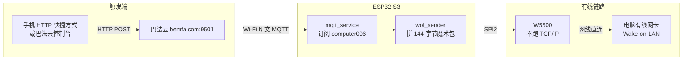

# 使用ESP32S3+W5500实现有线唤醒

## 前言

上一篇[使用ESP32S3实现Wake On Lan](/posts/2026/esp32s3_wol)的结尾留了个尾巴: 电脑长时间休眠后唤不醒, 当时怀疑是无线唤醒本身的问题, 顺手写了句"等后面有钱买树莓派了再说吧"

这事就一直搁在心里, 直到前段时间翻购物车, 才发现 W5500 模块才二三十块, 还是自带变压器和 RJ45 的那种, 那还买什么树莓派, 直接开造!

<!-- more -->

## 为什么这次换有线

上一篇的方案是让 ESP32-S3 用 Wi-Fi 发魔术包, 靠的是电脑网卡的**无线唤醒(WoWLAN)能力**, 也就是说整条链路里"睡着的那一方"必须一直保持在线: 网卡得持续供电, 还得和路由器保持关联

我猜问题就出在这, 电脑睡得越久, 网卡越有可能掉进更深的省电状态, 或者被 AP 那边判成不活跃客户端踢掉, 关联一断, 魔术包就根本送不到网卡手里, 自然唤不醒

有线就不一样了, 网线是点到点的一条链路, 只要电脑关/睡之后网口还有待机供电, 魔术包就一定能送到 PHY, 中间没有 AP, 没有隔离, 没有掉线, 也没有"网卡自己去省电"这一环

代价是笔记本的有线口被 W5500 占住了, 好在我平时上网全靠 Wi-Fi, 那个网口本来就闲着, 正好拿来直连

## 硬件

- ESP32-S3 开发板(还是大一那块, 没想到隔了这么多年还在服役)
- W5500 模块(带变压器 + RJ45, 类似 WIZ850io 那种)
- 杜邦线若干, 网线一根
- 一根 USB 线给板子供电(这玩意要 7×24 常开)

接线就是把 W5500 挂在 SPI 上, 我这里用的是 SPI2, 引脚如下(都能在 `menuconfig` 里改):

| 信号 | GPIO |
| --- | --- |
| SCLK | 12 |
| MOSI | 11 |
| MISO | 13 |
| CS | 10 |
| INT | 4(设为 `-1` 改成轮询) |
| RST | -1(模块没引复位脚就保持 -1) |

有两个坑要提前说: **SPI host 千万别选接 flash 的那个**, 不然一上电就寄; 另外 INT 没接的话记得设成 `-1` 走轮询, 否则中断永远等不到

## 方案

整体长这样:



(不知道是不是渲染问题, 图片好像没出来, 这里手动补一下)

```txt
手机 HTTP 快捷方式 / 巴法云控制台
        │  HTTP POST (apis.bemfa.com/va/postJsonMsg)
        ▼
   巴法云 bemfa.com:9501
        │  明文 MQTT over Wi-Fi
        ▼
  ESP32-S3 ── SPI2 ──► W5500 ── 网线直连 ──► 电脑网口（WOL）
```

和上一篇最大的区别是两条链路被有意拆开了, 互不干扰:

- **Wi-Fi** 只负责连巴法云收指令, 不承载业务数据
- **W5500** 不连路由器, 不跑 TCP/IP, 不做 DHCP, 只按原始二层帧把魔术包扔出去

这么做还有个附带好处: W5500 没有 IP, 也不会去抢 DHCP, 所以就算把它接到和电脑同一个交换机上也不会打架, 广播域内的机器都能收到这个帧(只要电脑在同一个广播域里, 直连当然是最省事的)

## 电脑端配置

和上一篇大同小异, 但有线网卡有几个地方必须单独确认:

- BIOS 里打开 WOL(我的主板里叫"网络唤醒", 各家名字不一样)
- 设备管理器 → 网络适配器 → 有线网卡 → 电源管理, 勾上"允许此设备唤醒计算机"和"只允许幻数据包唤醒计算机"
- 高级选项卡里打开"唤醒幻数据包"(`Wake on Magic Packet`), 有"关机唤醒"之类的选项一并打开
- **关机后网口必须保持供电**, 部分主板/网卡的 `ErP/EuP` 省电模式会直接切断网口待机电压, 这个一定要关掉, 不然关机唤醒是绝对不可能成功的
- 目标 MAC 必须是**有线网卡**的 MAC, 用 `getmac /v` 或者 `ipconfig /all` 看"以太网"那一项, 别填 Wi-Fi 的

再补一个我怀疑了很久的点: Windows 的**快速启动**(混合关机)会让"关机"实际变成一种类似休眠的状态, 网卡驱动的初始化路径可能和真正的冷启动不一样, 有条件的话建议先关掉快速启动再测关机唤醒. 具体是不是这个原因, 我还没折腾出来, 留个悬念

## 云端

上一篇是自己搭 `Mosquitto`, 能用但有点重: 得有台公网服务器, 还得自己签发证书, 而且想接米家还得再绕一圈

这次直接换成**巴法云**, 免费额度对我们这种只发一条指令的场景完全够用, 更重要的是它本身支持接入米家/小爱同学, 算是把上一篇结尾"后面可能会考虑接入米家"这句话给填上了(不过这条路后面又给了我一个"惊喜", 详见下面的吐槽)

流程很简单:

1. 在巴法云控制台新建一个 MQTT 主题, 比如 `computer006`
2. 拿到账号的**私钥**, 这个私钥直接当 MQTT 的 Client ID 用, 用户名密码留空就行
3. 服务器地址 `mqtt.bemfa.com`, 普通端口 `9501`(加密端口 `9503` 走 TLS1.2)

然后是安全提醒, 这几条和上一篇一样重要:

- 9501 是**明文** MQTT, 别拿来传敏感数据, 能上 9503 就上
- 私钥等同于设备身份, 泄露了别人就能拿你的主题乱发指令, **绝对不能提交到仓库**
- 主题名也算半个凭据, 别用太容易被猜到的

### 吐槽: 米家这条路没那么好走

这里必须吐槽一下, 也算是给打算走同一条路的人提个醒

我一开始就是冲着米家去的, 巴法云接进米家之后设备确实能看到, 但**真到要操控的时候才发现, 米家这边是要靠小爱音箱来下发的**, 而我家里压根没有小爱音箱

于是结果就很尴尬: 设备是接进去了, 但你既没有一个能点的入口, 也没有一个能喊的语音入口, **没有小爱音箱的话, 接入米家基本等于白接**. 这一趟纯属白折腾(~~所以动手之前真得先把链路从头到尾捋一遍~~)

### 那就绕过米家: 直接用 HTTP API

不甘心, 又把巴法云的文档从头翻了一遍, 才发现它其实是**开放 HTTP API** 的, 压根不需要米家这个中间商

接口简单到一个 curl 就够:

```text
POST https://apis.bemfa.com/va/postJsonMsg
Content-Type: application/json; charset=utf-8
```

请求体:

```json
{
  "uid": "控制台获取到的私钥",
  "topic": "主题",
  "type": 1,
  "msg": "事先约定好的信息"
}
```

四个字段的作用:

| 字段 | 说明 |
| --- | --- |
| `uid` | 控制台里那串私钥, 和项目里 `local/secret.txt` 写的是**同一个东西** |
| `topic` | 订阅的主题名, 我这里是 `computer006` |
| `type` | 主题类型, **1 是 MQTT**, 3 是 TCP; 我们走 MQTT, 所以填 1 |
| `msg` | 必须和单片机约定的一模一样, 我用的还是 `wake` |

发请求用的是手机上那个开源软件 **HTTP 快捷指令**([HTTP Shortcuts](https://github.com/Waboodoo/HTTP-Shortcuts)), 在桌面上建一个快捷方式, 点一下就发一次 POST, 比之前在 Termux 里敲 `mosquitto_pub` 顺手多了

这样一来整条链路就变成: 手机点一下 → HTTP POST 到巴法云 → 巴法云通过 MQTT 把 `wake` 推给 ESP32-S3 → W5500 从网线把魔术包发出去, 米家那一环被彻底去掉了

## 单片机

依旧是 ESP-IDF, 要求 **≥ 6.0**(我用的 v6.0.1), 依赖 `espressif/w5500` 和 `espressif/mqtt`, 首次编译要联网拉组件

代码分成了几个文件, 每个对应一个日志 TAG, 排错的时候看 TAG 就知道该去翻哪个文件:

```text
main/
  app_main.c             系统初始化与启动顺序
  mqtt_service.c         巴法云 MQTT 连接、订阅、事件分发
  command_dispatcher.c   topic / payload 严格匹配
  w5500_service.c        SPI 总线、W5500 MAC/PHY、链路状态
  wol_sender.c           原始 Ethernet/IPv4/UDP WOL 帧构造与发送
  status_led_service.c   可选 GPIO LED 关闭
```

跟上一篇一样, 代码是让 AI 搓的, 我只负责提需求、接线和排错, 不过里面有几个点我觉得挺有意思, 值得单独记一下

### W5500 没有出厂 MAC

W5500 是纯网卡芯片, 没有烧出厂 MAC 地址, 不管的话源地址就是全 0. 我的做法是读 ESP32-S3 的 Wi-Fi MAC, 把首字节的 `U/L` 位置 1 变成**本地管理单播地址**, 再写进 W5500:

```c
uint8_t mac[6];
esp_read_mac(mac, ESP_MAC_WIFI_STA);

// W5500 has no factory MAC address. Derive a stable locally administered
// unicast address from the ESP32-S3 Wi-Fi MAC instead of leaving it zero.
mac[0] = (uint8_t)((mac[0] & 0xFCU) | 0x02U);
esp_eth_ioctl(s_eth_handle, ETH_CMD_S_MAC_ADDR, mac);
```

这样每次启动的源 MAC 都是稳定的, 又不会和任何厂商的 OUI 冲突

### 手搓魔术包

因为 W5500 没挂到 `esp_netif` 上, 走的不是 lwip, 所以整个帧是手工拼的, 一共 144 字节:

| 部分 | 长度 |
| --- | --- |
| 以太网头(目的全 FF 广播) | 14 |
| IPv4 头 | 20 |
| UDP 头 | 8 |
| 魔术包载荷 `6×0xFF + 16×目标MAC` | 102 |

核心就这几行, 标准得不能再标准:

```c
uint8_t *magic = udp + UDP_HEADER_LEN;
memset(magic, 0xff, 6);
for (size_t i = 0; i < 16; ++i) {
    memcpy(magic + 6 + i * sizeof(s_target_mac), s_target_mac, sizeof(s_target_mac));
}
```

IPv4 头要自己算校验和(20 字节那个 `checksum`), 但 **UDP 的校验和在 IPv4 里填 0 是合法的**, 省掉了一整套伪头部计算, 这个便宜不占白不占

### 链路不通就拒发

被上一篇那种"包是发出去了, 电脑就是不理你"的经历教育过, 这次加了个显式检查, 链路没起来就不发, 并且打告警日志, 绝不静默失败:

```c
if (!w5500_service_is_link_up()) {
    ESP_LOGW(TAG, "W5500 link is down; WOL packet not sent");
    return ESP_ERR_INVALID_STATE;
}
```

### 私钥不进仓库

`local/secret.txt` 第一行写巴法云私钥, CMake 在配置阶段读出来生成 `build/generated/private_config.h`, 源码里只引用 `BEMFA_PRIVATE_KEY`. 文件不存在就直接 CMake 报错终止, 想偷偷漏掉这一步都不行, `local/` 也在 `.gitignore` 里

烧录流程还是老一套, 注意 `sdkconfig` 和 `build/` 都不入库, 新克隆的仓库必须先 `set-target`:

```bash
echo "你的巴法云私钥" > local/secret.txt
idf.py set-target esp32s3
idf.py menuconfig
idf.py build flash monitor
```

**单片机这里需要的物品**有: 巴法云私钥、主题名、约定的触发内容(我用的还是 `wake`)、电脑有线网卡的 MAC、Wi-Fi 的 SSID 和密码, 以及上面那张接线表

## 调试

推送还是老办法, 巴法云控制台点一下, 或者手机上点一下 HTTP 快捷方式, 主题 `computer006`, 内容 `wake`, 注意**必须是完整匹配**, 多一个换行或者空格都会被当成无效 payload 丢掉

设备端日志正常的话长这样:

```text
mqtt_service:       Connected to Bemfa MQTT
mqtt_service:       Subscribed, msg_id=...
command_dispatcher: Wake command received
wol_sender:         WOL magic packet sent through W5500
```

抓包这次方便多了, 因为 W5500 直连电脑网口, Wireshark 直接抓那个"以太网"接口就行, 不用像上次那样折腾无线网卡, 筛选器还是 `wol`:

```bash
33	4.120584	0.0.0.0	255.255.255.255	WOL	144	MagicPacket for 90:2a:ee:xx:xx:xx (电脑有线网卡的MAC地址)
```

能看到这行基本就说明帧本身没问题了, 剩下的锅都在电脑那边. 顺便说下这行的源地址是 `0.0.0.0`, 不是抓错了, 而是我们的帧整个是手工拼的, 源 IP 那一栏压根没填(留了全 0), 反正 WOL 也只看魔术包里的 MAC, 没人关心源 IP. 几个常见现象:

| 现象 | 原因与处理 |
| --- | --- |
| `W5500 link is down; WOL packet not sent` | W5500 和电脑之间没链路, 查网线、查两端 link 灯、查关/睡之后网口还供不供电 |
| `Ignoring message from unexpected topic` | 主题名对不上, 去巴法云控制台核对 |
| `Ignoring non-trigger payload` | payload 不是完整字符串, 多半是多了换行或空格 |
| 一直连不上 MQTT | 私钥对不对、Wi-Fi 能不能上网、9501 是不是明文端口 |
| 电脑不唤醒 | 优先排查电脑侧: BIOS/驱动/系统三处开关、有没有填成无线网卡 MAC、关机后网口有没有掉电 |

## 结果

折腾到这儿, 该说结论了, 说实话有点微妙. 先把这个容易混的地方说清楚: Windows 里**睡眠(S3)**内存还通着电, 机器其实在耗电; **休眠(S4)**是把内存写进硬盘再断电; **关机(S5)**就是彻底断电, 三者的网卡待机状态和唤醒路径完全不是一回事

| 电脑状态 | 结果 |
| --- | --- |
| 休眠(S4) | **可以唤醒** |
| 长时间睡眠(S3) | 还没测 |
| 关机(S5) | **依旧无法唤醒** |

有线之后**休眠(S4)是可以稳稳唤醒的**, 这至少证明固件、魔术包、链路这一整条路径是通的, 问题不在发送端. 但**关机(S5)依然唤不醒**, 和上次一样

有意思的是 S4 能唤醒, 说明网口在"内存都写进硬盘了"的状态下仍然保住了待机供电, 那按这个逻辑 S5 也该有电才对. 所以目前我的猜测集中在: 要么是关机后主板确实切断了网口供电(`ErP/EuP`), 要么是 Windows 快速启动把关机搞成了"假关机"从而走了另一条初始化路径, 要么就是这块网卡在 S5 下本来就不太行. 这几项得等哪天有空进 BIOS 一个个关掉再试了

至于**长时间睡眠(S3)**这一项, 恰恰是上一篇最像出问题的场景, 但这次还没抽出时间来复现, 所以先不下结论. 而且上一篇写的是"长时间休眠", 现在回头看那个措辞很含糊, 到底落在 S3 还是 S4 已经追溯不清了, 更得补测一遍, 免得又像上次那样折腾半天发现是别的原因

顺便说说功耗, 这玩意是 7×24 常开的, 量级是: W5500 模块链路 up 时大概 141 mA(占了全机八成的功耗), ESP32-S3 挂着 Wi-Fi 常连加默认 modem-sleep 大概 20~35 mA, 加起来 0.5W 出头, 一年电费可以忽略. 想省的话可以把 W5500 强制到 10 Mbps, 反正一次只发 144 字节, 用不着百兆

## 总结

对比上一篇, 有线唤醒确实比无线靠谱: 休眠(S4)能稳稳唤醒了, 抓包也直观, 链路通不通一眼就知道

但"关机唤醒"这个问题没能解决, 说明 WOL 这条路上的坑, 一大半根本不在发送端, 而在被唤醒的那台机器身上. 发送端怎么折腾都是把包扔出去, 包到了网口之后能不能把机器叫起来, 完全是主板和网卡的活

另外就是感慨一下, 上一篇结尾还在盘算树莓派, 结果最后是二十几块的 W5500 模块顶上了, 而且不用装系统、不用维护、通电就跑, 比树莓派适合这个场景多了(毕竟我只需要一个"以太网口", 不需要一台电脑)

还有个教训: 折腾之前一定要把链路从头到尾捋一遍, 我为了接米家白忙活了一场, 最后真正干活的只是一个 HTTP POST, 绕了一大圈又回到最简单的那条路上

后面如果能把关机唤醒折腾出来, 会在这篇文章下面更新

---

**版权声明**：本文为原创文章，转载请注明出处。
